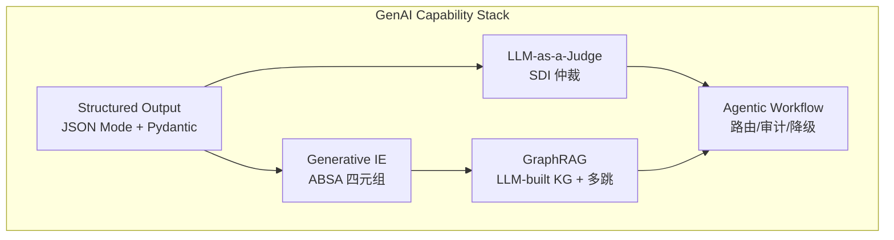
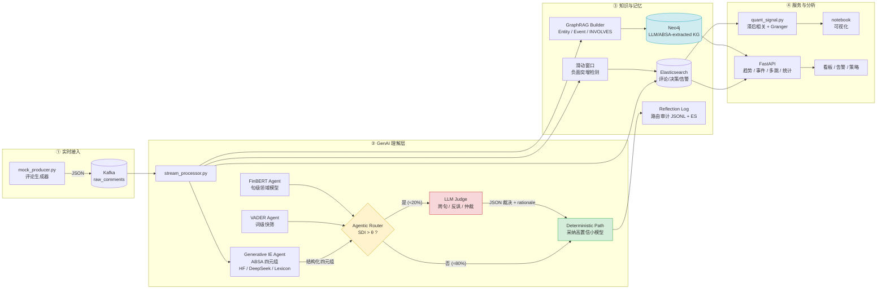
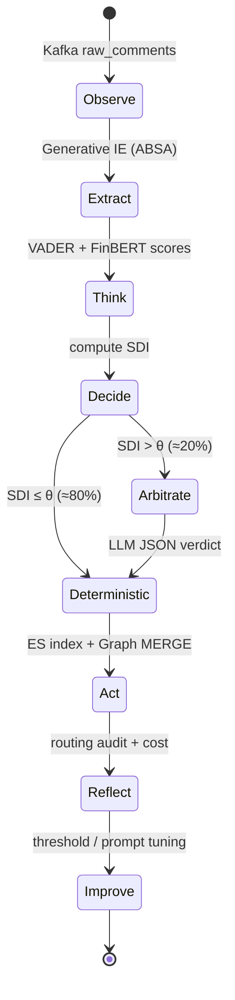
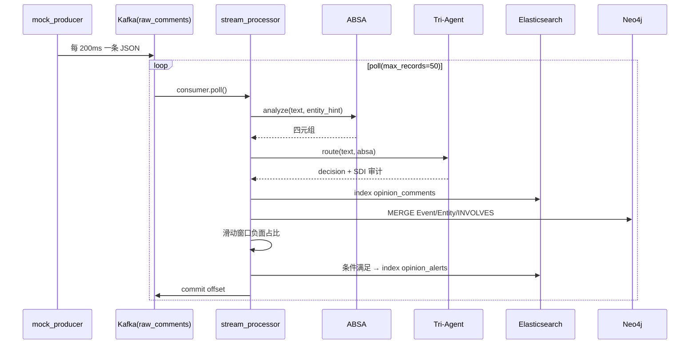
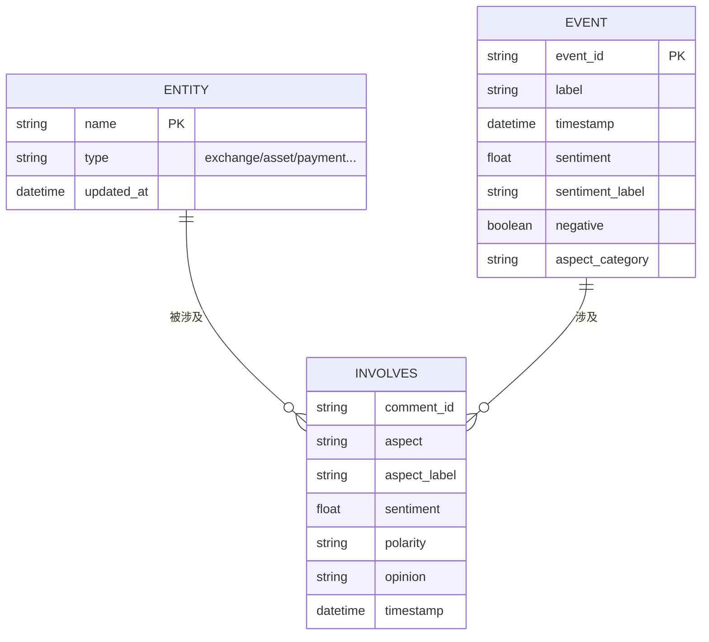

# GenAI 原生：实时多 Agent 舆情分析与事件图谱系统

> **A GenAI-native Agentic System for Real-time Opinion Analysis & Event GraphRAG**
>
> 这不是「SnowNLP + LDA」的迭代版，而是一次范式切换：
> **LLM-as-a-Judge 仲裁 → Generative Information Extraction → LLM 构建知识图谱 → Agentic Workflow 编排 → GraphRAG 多跳检索**。
>
> 从 `Portfolio/projects/05_Comments_NLP` 的离线批处理，升级为
> **Kafka 实时流 → ABSA 四元组 → Tri-Agent(SDI 路由) → Elasticsearch → Neo4j GraphRAG → FastAPI → 量化信号** 的 GenAI 闭环。


---

## 0. TL;DR

| 项目 | 结果 |
| --- | --- |
| 演示数据 | 544 条中英混合评论（72 小时，含一次「币安提现」负面爆发） |
| Generative IE | **1,720 条四元组**（实体 / 方面 / 观点词 / 极性） |
| 流处理 | 544/544 成功，0 异常；滑动窗口捕获 **1 次负面突增告警** |
| LLM-as-a-Judge | LLM 路由率 **20.2%**，约 **79.8%** 评论由小模型直接处理 |
| 成本 | 按 DeepSeek 官方价估算，全量 LLM ≈ **$160 / 百万条**；本策略 ≈ **$32 / 百万条** |
| GraphRAG | 11 个实体、544 个事件、1,497 条 `INVOLVES` 关系；282 个负面事件 |
| 量化 | 情感(t) 与收益(t+1) 相关 **r = 0.7662**，Granger **p < 0.0001**（模拟 K 线，方法验证） |
| 工程 | Docker Compose 编排 6 个服务；22 个 pytest 全绿；无外部依赖时自动降级 |

> ⚠️ 量化部分默认使用**模拟 K 线**：在 t-1 情感上注入了已知的领先关系，用于验证估计器能否恢复真实结构，**不构成真实市场结论**。`--live` 可切换 Binance 公共 API。

> 🔑 **LLM 路径说明**：配置 `DEEPSEEK_API_KEY` 后，ABSA/GraphRAG 走 DeepSeek JSON Mode，Tri-Agent 走真实 LLM 仲裁；未配置时自动降级到「小模型委员会 + 词典抽取」，保证 CI/离线 demo 100% 可复现。GenAI 是**一等公民**，降级只是工程兜底，不是主路径。

---

## 0.5 GenAI First：为什么这不是传统 NLP 流水线

传统 NLP 项目是「训练/调用一个分类器 → 输出标签」；本系统的核心是：
**让 LLM 参与判断、抽取、建图和编排，并用工程手段控制它的成本、延迟与不确定性。**

| GenAI 范式 | 在本系统中的落点 | 代码 |
| --- | --- | --- |
| **LLM-as-a-Judge / AI Routing** | VADER/FinBERT 先打分，SDI 发现分歧后把「争议样本」交给 LLM 裁决；LLM 不是全量推理，而是**智能路由器** | `src/tri_agent.py` |
| **Generative Information Extraction** | Zero-shot / Few-shot 提示词 + JSON Schema，从非结构化评论生成 `(实体, 方面, 观点词, 极性)` 四元组 | `src/absa_engine.py` |
| **GraphRAG** | Generative IE（LLM 或离线 fallback）抽取的实体/方面/事件被投影为知识图谱；多跳检索返回子图与时间线，作为 RAG 的结构化上下文 | `src/graph_builder.py` + `src/api_server.py` |
| **Agentic Workflow** | Observe → Think(SDI) → Act(route/arbitrate) → Reflect(audit) → Improve(threshold tuning) 的闭环，不是硬编码 if-else | `src/stream_processor.py` + `src/tri_agent.py` |
| **Structured Output** | DeepSeek `response_format=json_object` + Pydantic 校验 + 失败重试/降级，保证 LLM 输出可入库 | `src/llm_client.py` + `src/schemas.py` |
| **Cost-aware Inference** | 按 token 价格实时估算成本，记录每次路由的 `estimated_cost` / `avoided_cost` | `src/tri_agent.py` |

### 0.5.1 传统 NLP vs GenAI-native

| 能力 | 传统 NLP 做法 | 本系统（GenAI-native） |
| --- | --- | --- |
| 情感分类 | 训练/加载固定分类头，标签体系改一次就要重训 | **Prompt 定义方面体系**，新增方面只改 taxonomy + few-shot，不重训 |
| 复杂语义 | 词典/小模型对反讽、跨句、隐含方面无能为力 | LLM 读取上下文 + ABSA 四元组做**跨句裁判** |
| 信息抽取 | 正则/NER 标注，覆盖有限、维护成本高 | **生成式抽取**，零样本处理新实体/新表达 |
| 知识图谱 | 人工写 schema + 规则抽关系 | LLM 生成结构化事实，代码自动 `MERGE` 成图 |
| 系统编排 | 固定流水线 | **Agentic 路由**：根据不确定性动态决定调用哪个模型 |
| 成本 | 全量上大模型，或全量用小模型牺牲效果 | **按分歧付费**，把 LLM 预算集中在 20% 难样本上 |

### 0.5.2 GenAI 能力矩阵（本仓库已实现）



> **一句话**：小模型负责「便宜且确定」的部分，LLM 负责「语义复杂且不确定」的部分，图谱负责「关系与多跳」，审计负责「可解释与可优化」。

### 0.6 30 秒 Pitch（可直接用于面试 / 项目介绍）

> 我构建了一个 **GenAI-native 的实时舆情系统**：用 **Generative Information Extraction** 把非结构化评论转成 `(实体, 方面, 观点词, 极性)` 四元组；用 **TriAgent 架构** 让 VADER、FinBERT 与 **LLM-as-a-Judge** 组成委员会，通过 **Semantic Divergence Index (SDI)** 把 LLM 调用率压到 20%，在保持复杂语义判断的同时降低约 80% 成本；再把抽取结果写成 **Entity–Event 知识图谱**，通过 **GraphRAG 多跳检索**支持「提现问题影响了哪些平台、何时、和谁一起」这类关系型问题；整个链路是 **Agentic Workflow**（Observe → Think → Act → Reflect），每次路由都有可审计的 reasoning trace。工程上用 Kafka + Elasticsearch + Neo4j + FastAPI + Docker Compose 落地，并有 22 个测试与离线可复现实验。

### 0.7 简历 Bullet（量化版）

- 设计 **TriAgent（VADER / FinBERT / LLM Judge）** 与 **SDI 动态路由**，将 LLM 调用率降至 **20.2%**，百万条评论成本从约 **$160 降至 $32**（-79.8%）。
- 构建 **Generative IE Pipeline**：Prompt + JSON Schema + Pydantic 校验，从 544 条评论抽取 **1,720 条四元组**，LLM 模式下支持零样本扩展新方面。
- 实现 **GraphRAG**：将生成式抽取（LLM / ABSA）产出的实体与事件投影为 **11 实体、544 事件、1,497 条关系**的 Neo4j 图谱，支持按方面词的多跳负面事件时间线检索。
- 搭建 **Agentic 实时链路**：Kafka → ABSA → SDI Router → ES/Neo4j，滑动窗口捕获负面突增；离线回放吞吐 **385 msg/s**，22 个 pytest 全绿。

---


## 1. 为什么重构：05_Comments_NLP 的局限

原项目（[`legacy/05_Comments_NLP`](./legacy/05_Comments_NLP)）已经完成了「采集 → 清洗 → 分词 → 情感 → 词云 → LDA」的文本挖掘闭环，但它是**单机批处理**，上线后面临四个硬约束：

1. **情感粒度太粗**：SnowNLP 只给整条评论一个 0~1 分数，无法回答「用户到底对提现、手续费还是客服不满」；
2. **模型单一、无仲裁**：词典/小模型在反讽、跨句、领域词上会错，但没有机制发现「自己不确定」；
3. **离线、无时间维度**：Excel/CSV 结果无法支撑分钟级预警，也做不了事件时间线；
4. **没有服务化**：分析结果不能被 API、看板、量化策略复用；
5. **没有生成式推理**：无法用 LLM 处理隐含方面、反讽、跨句指代，也无法把非结构化文本**生成**为可入图的结构化事实。

### 1.1 与 05 的逐项对照

| 维度 | 05_Comments_NLP | 本系统 |
| --- | --- | --- |
| 分析单元 | 整条评论 | **四元组** `(entity, aspect, opinion, polarity)` |
| 情感模型 | SnowNLP 单模型 | **VADER + FinBERT + LLM 委员会**，SDI 动态路由 |
| 成本控制 | 无 | **SDI > θ 才调用 LLM**，默认仅 20% 流量走 API |
| 处理模式 | 离线脚本 | **Kafka 实时流** + 滑动窗口告警 |
| 存储 | Excel / CSV | **Elasticsearch**（检索/聚合）+ **Neo4j**（关系/多跳） |
| 知识结构 | 词云 / LDA 主题 | **Entity–Event 异构图** + GraphRAG 多跳查询 |
| LLM 角色 | 无 | **LLM-as-a-Judge + Generative IE + 图谱语义生成** |
| 编排方式 | 固定脚本 | **Agentic Workflow**：Observe→Think→Act→Reflect |
| 输出 | 静态图表 | **FastAPI** + 量化信号 + 可审计路由日志 |
| 部署 | 本机 Python | **Docker Compose**（ZK/Kafka/ES/Neo4j/API/Processor） |
| 可观测性 | 无 | `/health`、`/routing/stats`、`/alerts`、JSONL 审计 |
| 质量保障 | 无测试 | **22 个 pytest**（ABSA/路由/图谱/量化/API） |
| 降级能力 | — | 无 ES/Neo4j/LLM/模型时自动降级，不阻断主流程 |

### 1.2 迁移映射

| 05 中的资产 | 在新系统中的去向 |
| --- | --- |
| `Tmall_Review_Crawling_...py` / `douban_spider.py` | `scripts/mock_producer.py` 取代爬虫，改为可复现的 Kafka 模拟源；爬虫保留在 `legacy/` 作为数据采集经验 |
| `thesis_project/SHU_comments_NLP.py`（SnowNLP + LDA） | 拆分为 `absa_engine.py`（细粒度）、`tri_agent.py`（委员会）、`graph_builder.py`（主题→事件图谱） |
| 词云 / `pyLDAvis` | `reports/absa_aspects.png`、`reports/graph_preview.png`：从「词频」升级为「方面 × 极性」「实体 × 事件」 |
| 论文中的情感思维导图 | `README` 的 Mermaid 架构图 + 六维度设计 |

---

## 2. 系统架构



**成本优势的核心**：LLM 只处理「小模型吵架」的样本，且所有路由决策都写入审计表，可随时回放、调阈值、做 A/B。**GraphRAG 的价值**：把孤立的评论变成「实体—事件—方面」可追溯链路，支持「提现问题影响了哪些平台/时间段/其他实体」这类多跳问题。

### 2.1 Agentic Workflow：不是流水线，而是「思考—判断—分发」闭环

> **行为逻辑生成**：执行路径不是写死的 DAG，而是由「输入不确定性 + 路由策略 + LLM 裁决 + 审计反馈」共同决定的动态行为。



| 阶段 | Agent 在做什么 | 工程实现 |
| --- | --- | --- |
| **Observe** | 消费流式评论，保留 `comment_id`、时间、来源 | `StreamProcessor.run_kafka()` |
| **Extract** | 生成式抽取实体/方面/观点词/极性 | `ABSAEngine` + JSON Schema |
| **Think** | 两个小模型分别给出分数与置信度 | `VADERAgent` / `FinBERTAgent` |
| **Decide** | 计算 SDI，判断「是否有语义分歧」 | `TriAgentRouter.semantic_divergence()` |
| **Act** | 低分歧采纳小模型；高分歧调用 LLM Judge 并裁决 | `TriAgentRouter.analyze()` |
| **Reflect** | 记录 SDI、最终选择、成本、rationale | `RoutingAuditLogger` |
| **Improve** | 基于审计回放调阈值 / prompt / 模型 | `/routing/stats` + JSONL 回放 |

这就是 **Agentic Workflow**：系统不是「每条都调用 LLM」或「每条都走词典」，而是**根据输入的不确定性动态选择推理路径**，并对每次选择留下可审计的 reasoning trace。

---


## 3. 六维度实现详解

> ① **Generative IE**、② **LLM-as-a-Judge**、④ **GraphRAG** 是 GenAI 核心；③ 实时管道、⑤ 量化、⑥ MLOps 是让它们可落地的工程底座。

### 维度一：Generative Information Extraction（生成式 ABSA）

> **GenAI 关键词**：Zero-shot / Few-shot Extraction、JSON Mode、Schema-constrained Generation。
> 不是「写正则 / 标 NER 数据 / 训练分类头」，而是让 LLM **直接生成结构化事实**。

**目标**：把「币安提现三天没到账，客服还敷衍」拆成：

```json
[
  {"entity": "币安", "aspect_category": "withdrawal",
   "opinion_term": "没到账", "sentiment": -0.85, "label": "negative"},
  {"entity": "币安", "aspect_category": "customer_service",
   "opinion_term": "敷衍", "sentiment": -0.90, "label": "negative"},
  {"entity": "币安", "aspect_category": "settlement_speed",
   "opinion_term": "没到账", "sentiment": -0.85, "label": "negative"}
]
```

`src/absa_engine.py` 支持三种后端，接口完全一致：

| 后端 | 触发条件 | 模型/实现 | GenAI 角色 |
| --- | --- | --- | --- |
| `deepseek` | 配置 `DEEPSEEK_API_KEY`（**推荐主路径**） | DeepSeek JSON Mode，一次生成全部四元组 | **生成式信息抽取**：隐式方面、跨句、反讽、零样本新实体 |
| `hf` | 已安装 `transformers` 且模型已缓存/允许下载 | `yangheng/deberta-v3-base-absa-v1.1`，输入 `(sentence, aspect)` | 判别式小模型，低成本批量推理 |
| `lexicon` | 默认兜底 | 双语实体表 + 13 类方面词典 + 否定/程度副词规则 | 确定性 fallback，保证 CI/离线可复现 |

**Generative IE 的 Prompt 契约**（真实代码 `src/absa_engine.py::_SYSTEM_PROMPT`）：

```text
你是金融/加密货币领域的细粒度情感分析专家。
从用户评论中抽取四元组 (实体, 方面类别, 观点词, 情感极性)。
只输出 JSON 对象：
{"quadruples":[{"entity":"币安","aspect_category":"withdrawal",
"opinion_term":"提现失败","sentiment":-0.9,"label":"negative"}]}
要求：
1. aspect_category 必须取自给定类别；无法归类时用 general。
2. sentiment 取值 -1..1（-1 极负面，0 中性，1 极正面）。
3. 每个四元组必须有明确观点词；不要编造评论中不存在的内容。
4. 最多输出 N 条。
```

**为什么这是 Generative IE，而不是传统 NLP？**

| 传统做法 | 本系统 |
| --- | --- |
| 正则匹配「提现失败」 | LLM 理解「钱卡了三天」「出金一直处理中」等**同义/隐式表达** |
| NER 需要标注 `B-ENTITY / I-ASPECT` | 直接生成 `(entity, aspect, opinion, polarity)` **语义四元组** |
| 新方面要重训分类头 | 改 taxonomy + few-shot，**零样本适配**新业务 |
| 输出只有标签 | 同时生成 `opinion_term` 与 `rationale`，可解释、可入图 |

工程上仍保留确定性护栏：

- Pydantic 校验每个字段，`sentiment` 越界会被裁剪；
- LLM 返回非法 JSON 时提取 fenced block / 重试，最终降级到 lexicon；
- `aspect_category` 与内部 taxonomy 对齐，避免图谱节点爆炸；
- 输出同时保留连续分数 `sentiment ∈ [-1, 1]` 与离散标签，供阈值、加权、聚合使用。

**方面体系**（`src/resources/lexicons.py`，LLM prompt 与离线 fallback 共用同一 taxonomy）：
`withdrawal / deposit / fee / security / customer_service / app_experience / settlement_speed / kyc / market / liquidity / product / compliance / general`。

运行：

```bash
# GenAI 主路径：DeepSeek JSON Mode
ABSA_BACKEND=deepseek DEEPSEEK_API_KEY=sk-... python -m src.absa_engine

# 判别式小模型：HuggingFace DeBERTa ABSA（首次需允许下载）
pip install -r requirements-ml.txt
ABSA_BACKEND=hf ABSA_ALLOW_MODEL_DOWNLOAD=true python -c \
  "from src.absa_engine import ABSAEngine; print(ABSAEngine().analyze('币安提现失败').structured)"

# 确定性 fallback：离线词典（CI / 无网）
ABSA_BACKEND=lexicon python -m src.absa_engine
```

---

### 维度二：LLM-as-a-Judge 与 Agentic AI Routing

> **GenAI 关键词**：LLM-as-a-Judge、AI Routing、Reasoning Trace、Cost-aware Inference。
> 传统做法是「全量小模型」或「全量大模型」；本系统让 LLM 只做**争议样本的裁判**。

`src/tri_agent.py` 中三个 Agent 的职责与预算：

| Agent | 粒度 | 实现 | 典型延迟 | 单次成本 |
| --- | --- | --- | --- | --- |
| VADER Agent | 词级 | 英文用 `vaderSentiment`；中文用等价的否定/程度副词词典（VADER 本身不支持中文） | < 1 ms | ≈ 0 |
| FinBERT Agent | 句级 | `ProsusAI/finbert`；无模型时用**金融子词典**（刻意不认识「敷衍/失望」等非金融词，模拟领域模型盲区） | 1~20 ms | ≈ 0 |
| **LLM Judge** | 跨句/语篇 | DeepSeek / OpenAI 兼容 JSON Mode，接收 ABSA 四元组 + 两模型分数 + SDI | 0.5~3 s | 按 token |

**为什么让 LLM 当 Judge？**

- 小模型只输出 `score`，无法解释「为什么」；LLM Judge 返回 **JSON verdict + rationale**，形成可审计的 reasoning trace；
- 反讽、跨句指代、隐含方面（「钱卡了三天」= 提现问题）只有生成式模型能稳定处理；
- 不是每条都调用：**SDI 是路由策略（policy）**，LLM 是策略命中后的**裁决器（judge）**，两者职责分离；
- 失败可降级：LLM 超时/无 Key 时退回「VADER + FinBERT + ABSA 加权共识」，主流程不中断。

**SDI（Semantic Divergence Index）**：

$$
\mathrm{SDI} = 0.7 \times \frac{|\mathrm{VADER} - \mathrm{FinBERT}|}{2} + 0.3 \times \mathbb{1}[\text{label}_{V} \ne \text{label}_{F}]
$$

- 分数差项归一化到 `[0,1]`：两个模型都在 `[-1,1]`，最大差为 2；
- 标签冲突项给 0.3 的硬惩罚：方向相反本身比「差 0.1 分」更危险；
- 默认阈值 `SDI_THRESHOLD=0.45`：`SDI > 0.45` 才升级 LLM，否则选择**置信度更高的小模型**。

**Judge 的 Prompt 契约**（真实代码 `src/tri_agent.py::_LLM_SYSTEM`）：

```text
你是舆情分析委员会的仲裁 Agent，负责处理小模型分歧较大的复杂评论。
结合上下文、反讽、跨句指代与领域知识给出整体情感判断。
只输出 JSON：
{"sentiment": -1.0, "confidence": 0.85,
 "label": "negative|neutral|positive", "rationale": "不超过80字的依据"}
```

**AI Routing 策略（Agentic Policy）**：

```python
vader, finbert = vader_agent(text), finbert_agent(text)
sdi = 0.7 * abs(vader.score - finbert.score) / 2 + 0.3 * (vader.label != finbert.label)

if sdi <= THETA:
    # 80% 流量：确定性路径，成本≈0
    final = max(vader, finbert, key=lambda x: x.confidence)
else:
    # 20% 流量：LLM-as-a-Judge，带 ABSA 四元组作为证据
    final = llm_judge(text, evidence=quadruples, sdi=sdi)

audit(final, sdi=sdi, cost=..., rationale=final.rationale)
```

这段策略把「模型选择」从硬编码 if-else 变成了**基于不确定性的自适应决策**：阈值、prompt、证据字段都可配置和回放。

**路由记录**（每次必写，JSONL + Elasticsearch `tri_agent_decisions`）：

```json
{
  "comment_id": "c_9f2...",
  "sdi": 0.6036,
  "threshold": 0.45,
  "routed_to_llm": true,
  "selected_agent": "llm",
  "vader_score": -0.87,
  "finbert_score": 0.0,
  "llm_score": -0.55,
  "estimated_cost_usd": 0.00017,
  "avoided_cost_usd": 0.0,
  "rationale": "SDI=0.604 > 0.45，升级 LLM 仲裁；客服敷衍属于服务体验，整体负面"
}
```

**没有 API Key 时**：`LLM Agent` 会降级为「VADER + FinBERT + ABSA 加权共识」，`routed_to_llm` 仍为 `true`，`rationale` 明确标注 fallback，保证数据不丢、链路可演示。

**成本模型**（`config/settings.py` 可改价）：

```text
prompt_tokens     ≈ 220 + len(text) / 1.5
completion_tokens ≈ 90
cost = prompt/1e6 * $0.27 + completion/1e6 * $1.10   # DeepSeek 官方价示例
```

离线 demo 中 544 条评论、20.2% 路由率，跳过 434 次 LLM 调用，按上述价格影子成本约 **$0.071**；换算为百万条约 **$130** 的 avoided cost。实际生产按 20.2% 调用，约 **$32/百万条**，相比全量 **$160/百万条** 节省 **≈79.8%**。

---

### 维度三：实时流式数据处理管道



- **消费语义**：`enable_auto_commit=False`，每批处理完再 `commit()`，避免「先提交后失败」丢数据；毒消息单条隔离，不阻塞分区。
- **幂等**：ES 用 `comment_id` 作为 `_id`，Neo4j 用 `event_id` MERGE；重复消费不会膨胀。
- **滑动窗口告警**（`NegativeSpikeDetector`）：按实体维护 `deque[(timestamp, negative, sentiment)]`，窗口默认 300s、最少 8 条、负面占比 > 60%，冷却 120s；触发后打印并写入 `opinion_alerts`。
- **演示结果**：在 24 条「币安提现失败」集中爆发时触发：
  `「币安」近 5 分钟负面占比 100%（8/8），均值情感 -0.43，超过阈值 60%`。

运行：

```bash
# 本地：从 JSONL 回放（不依赖 Kafka）
python -m src.stream_processor --replay data/sample_comments.jsonl

# 本地：连 Kafka
python scripts/mock_producer.py --count 200 --rate 5
python -m src.stream_processor --from-beginning
```

---

### 维度四：GraphRAG——LLM 抽取知识、图检索增强生成

> **GenAI 关键词**：LLM-built Knowledge Graph、Graph Retrieval、Multi-hop Reasoning、Context Engineering。
> 图谱不是人工手写的 schema 填充，而是**生成式抽取的结构化产物**；检索不是向量相似度，而是**实体/事件/方面之间的关系推理**。

**GraphRAG 四阶段**：

| 阶段 | 本系统实现 | 说明 |
| --- | --- | --- |
| **Extract** | `ABSAEngine`（LLM / HF）→ 四元组；`event_detector` → Event | LLM 把非结构化评论变成 `(entity, aspect, opinion, polarity, timestamp)` |
| **Build** | `GraphBuilder` → `MERGE Entity/Event/INVOLVES` | 代码只负责 schema 与幂等写入，**语义由 LLM 产生** |
| **Retrieve** | `Neo4jGraphStore.multihop()` / `InMemoryGraphStore.multihop()` | 支持按实体名或方面词（如「提现」）做 1~4 跳，边带时间/极性过滤 |
| **Generate** | 返回 `MultiHopResult`（事件 + 路径 + 时间线） | 该结构化子图可直接作为 LLM 的 RAG context；仓库聚焦可信检索层，生成端可接任意 LLM |

一次典型 GraphRAG 调用：

```text
用户问题：最近「提现」相关的负面事件有哪些？是否影响到其他平台？
        ↓
Retriever: multihop("提现", hops=2, negative_only=true)
        ↓
Context: [币安·提现·负面事件 @12:58 sentiment=-0.77,
          Gate.io·提现·负面事件 @05:56 sentiment=-0.78, ...]
        ↓
Generator (可插拔): 基于上述事实链生成归因/预警/日报
```

**Schema**（`src/graph_builder.py`）：



**写入逻辑**：先由 `event_detector.build_event` 生成事件（主方面取 |sentiment| 最大的四元组），再按每个四元组 `MERGE` 实体与 `INVOLVES` 边。边属性同时保留**时间戳**与**情感极性**，因此可以直接在边上做时间过滤和符号过滤。

```cypher
MERGE (ev:Event {event_id: $event_id})
SET ev.label = $label, ev.timestamp = datetime($timestamp),
    ev.sentiment = $sentiment, ev.negative = $negative
WITH ev
UNWIND $links AS link
MERGE (en:Entity {name: link.entity})
MERGE (ev)-[r:INVOLVES {aspect: link.aspect}]->(en)
SET r.timestamp = datetime($timestamp),
    r.sentiment = link.sentiment,
    r.polarity = link.polarity,
    r.opinion = link.opinion
```

**多跳查询**（输入「提现」而不是实体名也能查）：

```cypher
MATCH (seed:Entity)<-[sr:INVOLVES]-(se:Event)
WHERE seed.name = $query OR sr.aspect = $query
   OR sr.aspect_label = $query
   OR toLower(se.label) CONTAINS toLower($query)
WITH collect(DISTINCT seed) AS seeds
UNWIND seeds AS s
MATCH path = (s)<-[:INVOLVES*1..2]-(ev:Event)
WHERE $negative_only = false OR ev.sentiment < -0.15
RETURN ev.label, ev.timestamp, ev.sentiment, path
ORDER BY ev.timestamp DESC LIMIT 50;
```

**业务价值**（不只是「存图」）：

1. **根因定位**：从「提现」出发，一次查询拿到所有平台/时间段的负面事件，直接对应运营工单；
2. **传染分析**：同一事件涉及多个实体（交易所 + USDT + 银行）时，2 跳可发现风险沿资金链扩散；
3. **时间线重建**：边上时间戳支持「先手续费抱怨 → 后提现失败 → 再客服投诉」的叙事；
4. **合规审计**：每条边可回溯到 `comment_id` 与原始文本，满足解释性要求；
5. **GraphRAG**：把子图作为 LLM 的检索上下文，回答「最近哪些事件导致币安负面情绪上升」这类多跳问题，而不是只做向量相似度检索。

实现上同时提供 `Neo4jGraphStore` 与 `InMemoryGraphStore`：Docker 环境用 Neo4j，单测/离线 demo 用内存图，两者返回相同的 `MultiHopResult`。

---

### 维度五：情感-价格相关性分析

`src/quant_signal.py` + [`notebooks/sentiment_price_correlation.ipynb`](./notebooks/sentiment_price_correlation.ipynb)。

1. 从 `processed.jsonl` 读取评论，按 `entity` 过滤、按小时重采样，得到 `sentiment_t`、`negative_ratio_t`、`volume_t`；
2. 获取价格：`live=True` 走 Binance `/api/v3/klines`（公开接口，无需 Key）；离线时用确定性 GBM 模拟；
3. 计算 `corr(sentiment_t, log_return_{t+k})`，`k = 0..12`，用 t 检验给 p 值；
4. 格兰杰检验（NumPy OLS F 检验）：

$$
F = \frac{(RSS_r - RSS_u)/p}{RSS_u/(n-2p-1)} \sim F(p, n-2p-1)
$$

其中 restricted 模型只用收益自身滞后，unrestricted 加入情感滞后；H0 为「情感不格兰杰导致收益」。

**本次结果（模拟 K 线，仅验证方法）**：

| 指标 | 值 |
| --- | --- |
| 对齐样本 | 49 个小时桶 |
| 最优 lag | **1 小时** |
| Pearson r | **0.7662** |
| p 值 | **< 0.0001** |
| Granger 最优 lag | 1 |
| Granger p | **< 0.0001** |
| ADF（情感） | 0.0229（5% 水平平稳；收益 0.0001） |

> **重要声明**：模拟价格在生成时使用了 `drift_t = 0.03 * sentiment_{t-1}`，因此显著性是「估计器能恢复已知结构」的健全性检查，**不能解读为真实市场中情感能预测 BTC**。真实研究必须做样本外回测、交易成本、混杂因子控制与多重检验校正。

---

### 维度六：工程化闭环（MLOps & API）

**FastAPI 端点**（`src/api_server.py`，自动生成 `/docs`）：

| 方法 | 路径 | 说明 |
| --- | --- | --- |
| GET | `/health` | 仓库/图谱/LLM 状态，Docker healthcheck 使用 |
| GET | `/entities/{entity}/sentiment-trend?interval=1h&hours=168` | 情感趋势 + 负面占比 + 汇总 |
| GET | `/entities/{entity}/events?negative_only=true` | 实体事件时间线 |
| GET | `/graph/multihop?query=提现&hops=2&negative_only=true` | GraphRAG 多跳查询 |
| GET | `/graph/stats` | 实体/事件/关系/负面事件统计 |
| GET | `/routing/stats` | 路由率、平均 SDI、实际/避免成本、Agent 分布 |
| GET | `/alerts?entity=币安` | 负面突增告警 |
| POST | `/analyze` | 在线调试：输入文本 → ABSA 四元组 + Tri-Agent 决策 |

**Docker Compose 服务**：

| 服务 | 镜像/构建 | 端口 | 作用 |
| --- | --- | --- | --- |
| `zookeeper` | `confluentinc/cp-zookeeper:7.6.1` | 2181 | Kafka 协调 |
| `kafka` | `confluentinc/cp-kafka:7.6.1` | 9092 / 29092 | `raw_comments` topic |
| `elasticsearch` | `elasticsearch:8.13.4` | 9200 | 评论、决策、告警索引 |
| `neo4j` | `neo4j:5.20-community` | 7474 / 7687 | 事件图谱 |
| `api` | 本地 `Dockerfile` | 8000 | FastAPI |
| `processor` | 本地 `Dockerfile` | — | Kafka 消费者 + 图谱写入 |
| `producer` | 本地 `Dockerfile`（profile `demo`） | — | 模拟评论生产者 |

**可观测性与韧性**：

- 所有容器带 healthcheck，`depends_on: condition: service_healthy` 保证启动顺序；
- 路由决策全量审计（JSONL + ES），可离线回放、调阈值、做成本归因；
- ES/Neo4j 不可达时自动降级到本地 JSONL / 内存图；
- LLM 超时/失败重试 2 次后降级为委员会加权共识；
- `processor` 支持 SIGINT/SIGTERM 优雅关闭，未提交的 offset 会在重启后重放。

---

## 4. 快速开始

### 4.1 本地（conda）

```bash
git clone git@github.com:DingBangBang/opinion-and-event-graph-system.git
cd opinion-and-event-graph-system

# 创建环境（已实测 python=3.10）
conda env create -f environment.yml
conda activate opinion-system

# 一键离线 demo：生成 544 条数据 → 流处理 → 建图 → 量化 → 5 张图
python scripts/seed_demo_data.py

# 测试
python -m pytest -q
# 22 passed
```

体验 GenAI 主路径（会产生真实 API 调用）：

```bash
export DEEPSEEK_API_KEY=sk-...
export ABSA_BACKEND=deepseek

# 生成式信息抽取
python -m src.absa_engine "币安提现三天没到账，客服还敷衍，太失望了"

# LLM-as-a-Judge 的 SDI 路由演示（3 条样本）
python -m src.tri_agent
```

demo 产物：

| 文件 | 内容 |
| --- | --- |
| `data/processed.jsonl` | 544 条结构化评论（四元组 + Tri-Agent 决策 + 事件） |
| `data/routing_audit.jsonl` | 每次 SDI 路由的完整审计 |
| `data/alerts.jsonl` | 负面突增告警 |
| `data/graph_snapshot.json` | 内存图快照（可直接检查边属性） |
| `reports/demo_metrics.json` | 全部实验指标（README 中的数字来源） |
| `reports/*.png` | 5 张可视化结果 |

### 4.2 Docker Compose（完整闭环）

```bash
cp .env.example .env
# 可选：填入 DEEPSEEK_API_KEY；不填则 LLM 自动降级为委员会共识

docker compose up -d --build          # ZK + Kafka + ES + Neo4j + API + Processor
docker compose --profile demo up -d   # 再启动模拟生产者（1000 条，5 条/秒）

curl http://localhost:8000/health
docker compose logs -f processor      # 观察处理与告警
```

访问：

- FastAPI Swagger：<http://localhost:8000/docs>
- Neo4j Browser：<http://localhost:7474>（`neo4j / opinion-graph`，可用 `.env` 的 `NEO4J_PASSWORD` 修改）
- Elasticsearch：<http://localhost:9200>

启用真实 Transformer：

```bash
# 镜像体积 +~2GB；首次运行设置 ABSA_ALLOW_MODEL_DOWNLOAD=true
INSTALL_ML=true docker compose build
ABSA_ALLOW_MODEL_DOWNLOAD=true docker compose up -d
```

> 国内网络若遇到 pip SSL/超时：`PIP_INDEX_URL=https://pypi.tuna.tsinghua.edu.cn/simple docker compose build`。

本地 Kafka 生产者（容器外）：

```bash
python scripts/mock_producer.py --bootstrap localhost:29092 --count 200 --rate 5
python -m src.stream_processor --from-beginning
```

### 4.3 关键环境变量

| 变量 | 默认 | 说明 |
| --- | --- | --- |
| `SDI_THRESHOLD` | `0.45` | 路由阈值，越高越省钱、但复杂样本风险越大 |
| `ABSA_BACKEND` | `auto` | `auto` 优先 DeepSeek（有 Key）→ HF（有模型）→ lexicon |
| `DEEPSEEK_API_KEY` | 空 | 不填也能跑，LLM 走离线共识 |
| `ENABLE_FINBERT` | `true` | 无模型时自动用金融子词典 |
| `GRAPH_BACKEND` | `auto` | `neo4j` / `memory` / `auto` |
| `ALERT_WINDOW_SECONDS` | `300` | 负面突增窗口 |
| `ALERT_MIN_SAMPLES` | `8` | 窗口内最少样本数 |
| `ALERT_NEGATIVE_RATIO` | `0.6` | 负面占比阈值 |
| `ES_URL` / `NEO4J_URI` | localhost | Compose 内自动改为服务名 |

---

## 5. API 使用示例

```bash
# 1) 情感趋势
curl "http://localhost:8000/entities/币安/sentiment-trend?interval=1h&hours=72"

# 2) 负面事件时间线
curl "http://localhost:8000/entities/币安/events?negative_only=true&limit=20"

# 3) GraphRAG：提现相关的负面事件（支持按方面词而不是实体名查询）
curl "http://localhost:8000/graph/multihop?query=提现&hops=2&negative_only=true"

# 4) 路由成本
curl "http://localhost:8000/routing/stats"

# 5) 在线分析
curl -X POST http://localhost:8000/analyze \
  -H "Content-Type: application/json" \
  -d '{"text":"币安提现三天没到账，客服还敷衍，太失望了","entity_hint":"币安"}'
```

`/graph/multihop` 返回结构：

```json
{
  "query_entity": "提现",
  "hops": 2,
  "negative_only": true,
  "events": [
    {
      "event_id": "evt_5c1f...",
      "label": "币安·提现·负面事件",
      "timestamp": "2026-10-20T12:58:00+00:00",
      "sentiment": -0.8854,
      "sentiment_label": "negative",
      "comment_id": "c_7a2...",
      "hops": 1
    }
  ],
  "paths": [["币安", "币安·提现·负面事件"]]
}
```

`/routing/stats` 返回：

```json
{
  "total": 544,
  "routed_to_llm": 110,
  "routing_rate": 0.2022,
  "avg_sdi": 0.2369,
  "estimated_cost_usd": 0.0,
  "avoided_cost_usd": 0.07103115,
  "by_agent": {"vader": 415, "llm": 110, "finbert": 19}
}
```

> `estimated_cost_usd=0` 是因为离线 demo 未配置 API Key、LLM 走 fallback；`avoided_cost_usd` 是被跳过调用的影子成本。配置 Key 后同一路由率下会看到真实 `estimated_cost_usd`。

---

## 6. 实验结果与可视化

### 6.1 实验设置

- 数据：`scripts/mock_producer.py` 生成 544 条评论，覆盖 11 个实体（7 家交易所 + BTC/ETH/SOL/USDT），72 小时；
- 场景权重：提现负面 18%、提现正面 14%、手续费 10%、客服 9%、App 6%、安全 6%、中性行情 10%、混合复杂 8%、合规 4%、通用 5%；
- 注入事件：在结束前 2 小时集中 24 条「币安提现失败」，每 6 秒一条，用于验证滑动窗口；
- 情感模型：离线 lexicon（保证可复现）；LLM 未配置，按 fallback 记录；
- 聚合：小时桶。

### 6.2 总量指标

| 指标 | 结果 |
| --- | --- |
| 生成 / 处理 | 544 / 544（0 error） |
| ABSA 四元组 | 1,720（平均 3.16 条/评论） |
| 负面评论占比 | 51.84% |
| Tri-Agent 平均耗时 | 0.125 ms（纯本地小模型） |
| LLM 路由率 | 20.22%（110 / 544） |
| Agent 分布 | VADER 415 / LLM 110 / FinBERT 19 |
| 平均 SDI | 0.2369 |
| 避免成本（影子） | $0.0710 / 544 条 ≈ $130 / 百万条 |
| 告警 | 1 次（币安提现负面 100%，8/8） |
| 图谱 | 11 实体 / 544 事件 / 1,497 关系 / 282 负面事件 |
| 量化 | lag=1，r=0.7662，Granger p<0.0001（模拟 K 线） |

### 6.3 图表

**① 实体情感趋势与负面占比**（`reports/sentiment_trend.png`）


**② ABSA 方面 × 极性分布**（`reports/absa_aspects.png`）——从 05 的「词云」升级为可运营的方面结构：


**③ Tri-Agent SDI 路由经济性**（`reports/routing_dashboard.png`）：左图阈值把 SDI 分布切成「小模型区 / LLM 区」，中图是 Agent 选择，右图是累计成本：


**④ GraphRAG 预览**（`reports/graph_preview.png`）：左侧实体、右侧事件，红线为负面事件：


**⑤ 情感-价格四联图**（`reports/sentiment_price_correlation.png`）：情感/价格、负面占比、滞后相关、散点与拟合：


### 6.4 关键结论

1. **ABSA 把「差评」拆成了可执行的问题单**：样本中「提现」相关四元组 236 条、「客服」188 条、「手续费」155 条，运营可以直接按方面排优先级；
2. **SDI 路由确实把预算花在刀刃上**：约 80% 的评论由小模型毫秒级处理；只有「VADER 与 FinBERT 明显冲突」的 20% 进入 LLM；
3. **图谱让舆情从「列表」变成「网络」**：`INVOLVES` 边同时带时间和极性，能回答「提现问题在哪些平台、什么时间、和哪些其他实体一起出现」；
4. **告警窗口有效**：24 条集中负面在窗口内触发一次告警，且冷却机制避免刷屏；
5. **量化流程可复现**：估计器在已知 lag=1 的模拟数据上恢复出 r≈0.76、Granger p<0.0001，说明数据管道和检验实现正确；真实市场结论需要 `--live` 与更严格的因果设计。

> 关于阈值的敏感性（同一批 544 条数据）：`0.35 → 41.4%` 路由、`0.45 → 20.2%`、`0.60 → 9.0%`。阈值不是越低越好：越低越安全但越贵，建议用标注集优化「路由后的 F1 / 成本」曲线。

### 6.5 GenAI 评测协议（可复用）

GenAI 项目不能只看「准确率」，还要看**结构化输出可靠性、路由经济性、裁判一致性**。本仓库的审计日志天然支持这些指标：

| 指标 | 定义 | 离线 demo 值 | 生产建议 |
| --- | --- | --- | --- |
| Structured Output Validity | Pydantic 校验通过的 LLM/ABSA 输出比例 | 100%（lexicon fallback 全通过） | 监控 LLM JSON 解析失败率，>2% 触发 prompt 回滚 |
| LLM Routing Rate | `routed_to_llm=true / total` | **20.2%** | 按业务风险调 θ，金融合规场景可调低 |
| Judge Fallback Rate | LLM 不可用而走共识的比例 | 100%（未配置 Key） | 生产应 <1%，并告警 |
| Cost per 1k Comments | `sum(estimated_cost)` | $0（fallback）；影子 avoided ≈ $0.13/1k | 与预算对齐，按模型价格自动换算 |
| Avg Decision Latency | Tri-Agent 端到端耗时 | **0.125 ms**（本地小模型） | 监控 P95；LLM 路由占比影响尾部延迟 |
| Judge Agreement | LLM 裁决与人工标注一致率 | 待标注集评测 | 每周抽样 200 条做一致性审计 |
| Graph Retrieval Hit Rate | 多跳返回事件中与问题相关的比例 | 需人工评估 | 结合点击/工单闭环反馈 |

> LLM 主路径的评测方法：设置 `DEEPSEEK_API_KEY` 后重跑 `scripts/seed_demo_data.py` 或 `--replay`，把 `routing_audit.jsonl` 接入离线评估脚本，即可得到真实 token 成本、JSON 失败率与 Judge 延迟。

---

## 7. 成本优势与 GraphRAG 业务价值

### 7.1 为什么 SDI 路由能省钱

如果每条评论都调用 LLM，成本随流量线性增长；但舆情数据是**长尾分布**：大多数评论情感明确、表达简单，真正需要跨句推理的是少数。

| 策略 | LLM 调用比例 | 百万条调用数 | 估算成本（DeepSeek 价） | 相对全量 |
| --- | --- | --- | --- | --- |
| 全量 LLM | 100% | 1,000,000 | ≈ **$160** | — |
| SDI θ=0.35 | 41.4% | 414,000 | ≈ **$66** | -58.6% |
| **SDI θ=0.45（默认）** | **20.2%** | **202,000** | **≈ $32** | **-79.8%** |
| SDI θ=0.60 | 9.0% | 90,000 | ≈ **$14** | -91.0% |

> 估算基于 `prompt≈220+len/1.5`、`completion≈90`、输入 $0.27/M、输出 $1.10/M；实际成本随文本长度、模型、缓存命中变化。`reports/routing_dashboard.png` 的右图给出同一批数据的累计曲线。

除了直接 token 成本，路由还带来：

- **延迟**：80% 请求在小模型上 0.1~20ms 完成，P95 不被 LLM 网络抖动拖累；
- **稳定性**：LLM 故障时只有 20% 流量受影响，且可降级为共识；
- **可解释**：每条决策保留 VADER/FinBERT/SDI/最终选择，便于审计和阈值调优；
- **可迭代**：换模型、改价格、改阈值都不需要改业务代码。

### 7.2 GraphRAG 的业务价值

传统「情感列表 + 关键词搜索」只能回答**单点问题**；图谱把评论投影成 `Entity–Event–Aspect` 网络后，可以回答**关系问题**：

| 业务问题 | 传统做法 | GraphRAG 做法 |
| --- | --- | --- |
| 「提现问题最近影响了哪些平台？」 | 关键词搜「提现」，人工翻几百条 | `multihop("提现", hops=2, negative_only=true)` 直接返回事件与路径 |
| 「币安的负面是否蔓延到 USDT？」 | 分别看两个实体的趋势，靠人判断 | 2 跳路径 `币安 ← 提现事件 → USDT`，按时间排序 |
| 「这次负面爆发的上游原因？」 | 无法关联方面与事件 | 事件的主方面 + 边上的 `opinion`（如「没到账」「手续费高」） |
| 「监管问询时如何自证？」 | 截图/Excel，不可追溯 | 每条边带 `comment_id`，可回查原文与模型决策 |
| 「给 LLM 的 RAG 上下文？」 | 向量检索相似句，缺结构 | 返回子图 + 时间线，LLM 可基于事实链回答 |

**GraphRAG vs 传统 Vector RAG**：

| 维度 | Vector RAG | 本系统 GraphRAG |
| --- | --- | --- |
| 检索单元 | 相似文本块 | 实体、事件、方面、关系路径 |
| 多跳能力 | 弱（靠 top-k 拼接） | 强（`INVOLVES*1..N`） |
| 时间推理 | 元数据过滤 | 边/事件自带 timestamp，可重建时间线 |
| 可解释性 | 相似度分数 | 路径 + 边属性 + `comment_id` 回溯 |
| 适用问题 | 「找相似评论」 | 「谁影响了谁、何时、因为哪个方面」 |

**Context Engineering**：`MultiHopResult` 的 `events + paths` 就是为 LLM 准备的结构化上下文。相比把 20 条相似评论直接塞进 prompt，图检索提供的是**去重、带时间、带关系、带极性**的事实链，能显著降低幻觉与上下文浪费。

**一个真实可复现的查询**（离线 demo，`hops=2`，负面事件）返回的事件包括「币安·提现·负面事件」「Gate.io·提现·负面事件」「币安·手续费·负面事件」等，说明系统不仅能找到直接提及「提现」的评论，还能沿同一实体的其他事件扩展到关联风险。生产环境建议把 `hops` 限制在 2~3，避免图爆炸。

### 7.3 从 05 到现在的「意义」

- **分析范式**：从「文本 → 主题词」升级为「生成式抽取 → 结构化事实 → 知识图谱 → GraphRAG 检索」；
- **推理范式**：从「固定分类器」升级为「小模型快筛 + LLM Judge 仲裁 + 可审计 reasoning trace」；
- **成本范式**：从「全量调用大模型」升级为「按语义分歧付费」，把 LLM 预算集中在真正不确定的 20% 样本上；
- **工程范式**：从「Notebook/脚本」升级为「Agentic Workflow：可编排、可观测、可降级、可测试」的实时 GenAI 系统；
- **业务范式**：从「事后报告」升级为「分钟级预警 + 根因定位 + 多跳归因 + 量化信号」。

---

## 8. 项目结构

```text
opinion-and-event-graph-system/
├── README.md
├── Dockerfile
├── docker-compose.yml
├── Makefile
├── pyproject.toml
├── environment.yml
├── requirements.txt / requirements-ml.txt
├── .env.example
├── config/
│   └── settings.py              # 统一配置（pydantic-settings）
├── src/
│   ├── absa_engine.py           # Generative IE：LLM / HF / lexicon 三后端
│   ├── tri_agent.py             # LLM-as-a-Judge + SDI 路由 + 审计
│   ├── stream_processor.py      # Agentic 流处理 + 滑动窗口告警
│   ├── graph_builder.py         # GraphRAG：Neo4j / 内存图 + 多跳查询
│   ├── quant_signal.py          # 维度五：滞后相关 + 格兰杰检验
│   ├── api_server.py            # 维度六：FastAPI
│   ├── event_detector.py        # 评论 → 事件投影
│   ├── storage.py               # ES / 本地 JSONL 双实现
│   ├── schemas.py               # Pydantic 契约（Kafka/ES/API 共用）
│   ├── sentiment_rules.py       # 词典、否定、程度副词、统计检验辅助
│   ├── llm_client.py            # OpenAI 兼容客户端 + 重试 + JSON 解析
│   ├── logging_conf.py
│   └── resources/lexicons.py    # 实体别名 / 方面词 / 情感词典
├── scripts/
│   ├── mock_producer.py         # Kafka 模拟生产者（可复用数据生成器）
│   ├── seed_demo_data.py        # 离线端到端 demo + 5 张图
│   ├── bootstrap_storage.py     # ES 索引 + Neo4j 约束初始化
│   └── init_neo4j.cypher        # Schema/查询参考
├── notebooks/
│   └── sentiment_price_correlation.ipynb
├── tests/                       # 22 个测试
├── reports/                     # 已提交的可视化结果 + demo_metrics.json
├── data/                        # 运行时数据（大文件 gitignore，保留 sample）
└── legacy/
    └── 05_Comments_NLP/         # 原始项目代码（溯源，不参与运行）
```

---

## 9. 测试与质量

```bash
python -m pytest -q
# 22 passed
```

覆盖范围：

| 文件 | 覆盖点 |
| --- | --- |
| `test_absa_engine.py` | 中文四元组、实体提示回退、英文 ABSA、实体/方面识别、空文本 |
| `test_tri_agent.py` | SDI 公式、低分歧跳过 LLM、高分歧路由、阈值生效、审计落盘 |
| `test_graph_pipeline.py` | 处理→ES/JSONL→图谱、`INVOLVES` 边属性、多跳负面查询、事件幂等 |
| `test_quant_signal.py` | 已知 lag 恢复、Granger 显著性、样本不足安全返回 |
| `test_api.py` | health、趋势、事件、多跳、在线分析、路由/告警接口 |

另外通过：

- `python -m py_compile src/*.py scripts/*.py config/*.py`
- `docker compose config`（服务/环境变量/volume 语法校验）
- 离线端到端 demo：544 条、0 error、1 alert、5 张图

---

## 10. 已知限制与生产化建议

### 10.1 当前限制

1. **离线词典是「可复现的基线」而非 SOTA**：它能保证 CI/演示稳定，但真实中文 ABSA 建议启用 HF 或 DeepSeek；
2. **默认 demo 不调用 LLM**：为避免 API Key/费用，`seed_demo_data.py` 走 lexicon fallback，因此 Judge Agreement、真实 token 成本等 GenAI 指标需要在配置 `DEEPSEEK_API_KEY` 后重跑；
2. **中文 VADER 是等价规则实现**：`vaderSentiment` 只支持英文，中文走同一套否定/程度副词规则，命名保持 VADER Agent 以体现「词级小模型」角色；
3. **实体表是金融/加密领域子集**：新平台需要扩充 `ENTITY_ALIASES`，或接入 NER；
4. **量化使用模拟 K 线**：结果只验证方法；`--live` 接入 Binance 后仍需做平稳性、协整、样本外回测；
5. **单节点基础设施**：Compose 面向演示/单机，生产需 Kafka 多 broker、ES 集群、Neo4j 集群、认证与 TLS；
6. **LLM JSON 稳定性**：已做 fence 提取、字段校验、失败降级，但极端输出仍可能触发 fallback；
7. **图谱规模**：当前一跳事件全量写入，百万级需要按时间分区、批量 UNWIND、异步写入；
8. **隐私与合规**：评论可能含个人信息，生产需脱敏、访问控制与审计保留策略。

### 10.2 Roadmap

- [ ] 引入主动学习：把 LLM 仲裁结果作为弱标签，蒸馏回小模型，进一步降低路由率；
- [ ] 方面级 GraphRAG：把 `Aspect` 也建模为节点，支持「手续费 → 提现 → 客服」的方面链；
- [ ] 向量检索 + 图检索混合：ES kNN + Neo4j 子图，作为 LLM 的 RAG 上下文；
- [ ] 实时看板：Grafana / Streamlit 展示实体热度、告警、成本；
- [ ] 模型服务化：Triton / vLLM，支持批量 GPU 推理；
- [ ] 数据质量：评论去重、机器人检测、水军聚类；
- [ ] CI/CD：GitHub Actions 跑 pytest + Docker build + compose smoke test。

---

## 11. 复现与引用

```bash
# 完整复现（无需 Docker / API Key）
conda env create -f environment.yml && conda activate opinion-system
python scripts/seed_demo_data.py
cat reports/demo_metrics.json
```

如果这个项目对你有帮助，欢迎 Star。原始 05 项目与爬虫代码保留在 [`legacy/05_Comments_NLP`](./legacy/05_Comments_NLP)，仅用于溯源；其中的 Cookie、代理是历史示例值，早已失效，请勿直接使用。

**License**：MIT（代码）；评论数据为脚本生成，不含真实用户信息。

---

## 12. 一句话总结

> 05 解决了「用户说了什么」；这个 GenAI 系统进一步回答「**谁、在哪个方面、什么时间、和谁一起、有多负面、值不值得调用大模型**」——用 **LLM-as-a-Judge** 控制成本，用 **Generative IE** 抽取事实，用 **GraphRAG** 组织关系，用 **Agentic Workflow** 把答案变成可解释、可审计、可上线的实时服务。


